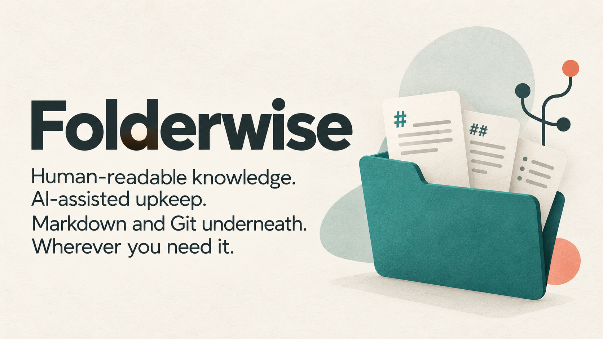
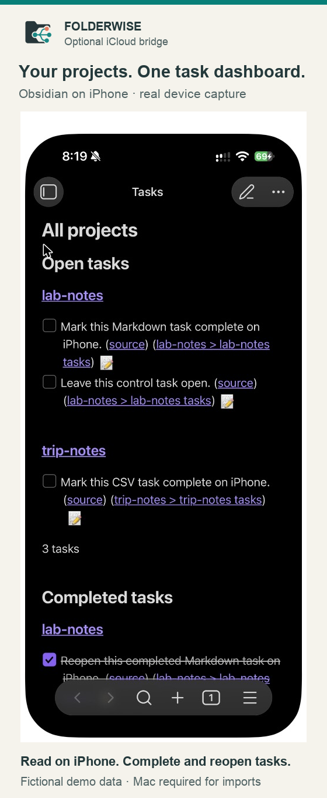
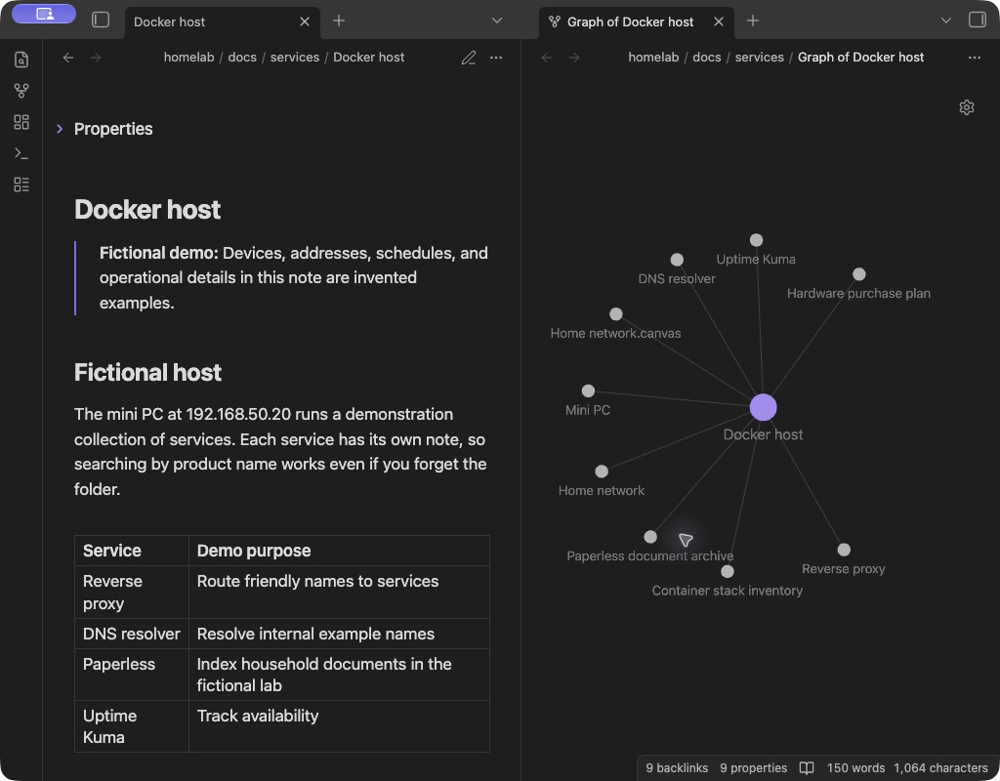

<div align="center">

<h1></h1>

[](#-getting-started)
[](docs/guide.md)
[](LICENSE)
[](https://github.com/TheLinuxGuy/folderwise/actions/workflows/ci.yml)
[](https://codecov.io/gh/TheLinuxGuy/folderwise)
[](https://github.com/TheLinuxGuy/folderwise/releases/latest)

[Overview](#-a-place-for-what-you-know) · [What's new](#-whats-new) · [Get started](#-getting-started) · [iPhone workflow](#-your-projects-on-iphone) · [Documentation](docs/guide.md)

</div>

## 📚 A place for what you know

You solved it once. Keep the instructions, the evidence, and the decisions somewhere you can find them again.

**Folderwise** is a Markdown-and-Git framework for knowledge that humans read and AI agents help maintain. Create dedicated projects for your home network, household records, technical runbooks, or anything you expect to revisit.

| 🗂️ Organize | 🛠️ Maintain | 🔎 Revisit |
|---|---|---|
| One topic, one folder, one Git history. | Shared rules, change stamps, and checks. | Generated indexes, review dates, and optional Obsidian views. |

## 🆕 What's new

**[Folderwise 0.1.0](https://github.com/TheLinuxGuy/folderwise/releases/tag/v0.1.0): the first release.**

- 📦 **Downloadable releases.** Zip and tar.gz archives with `SHA256SUMS`, built from one recorded commit and extracted and tested on Linux and macOS before they are offered. Cloning is still recommended; archives have no Git history.
- ✅ **Tested on every change.** 400+ tool and public-documentation checks run on Linux (Python 3.10 and 3.15) and macOS (Python 3.15), with a clean-machine install check and 85% production line coverage required.
- 🛡️ **Guarded framework repository.** Only approved framework files can enter it; your knowledge projects, caches and credentials cannot.
- 🔁 **Safe archive upgrades.** Step-by-step, no overwrite, no reset, and your projects are never touched: [upgrading an archive install](docs/framework-checkout.md#upgrading-an-archive-install).
- 🪟 **Platforms.** Linux and macOS. Native Windows is not supported; use WSL.

See the [release notes](https://github.com/TheLinuxGuy/folderwise/releases/tag/v0.1.0) for the full list of changes.

## 🚀 Getting started

**Requires:** 🧑‍💻 Git with a configured author identity, 🐍 Python 3.10+, and ⚡ [uv](https://docs.astral.sh/uv/getting-started/installation/).

**Platforms:** 🍎 macOS and 🐧 Linux (CI tests Python 3.10 and 3.15 on Linux and 3.15 on macOS). Native Windows is not supported or tested: the Git hooks are POSIX `sh` scripts, so use WSL.

```sh
git clone https://github.com/TheLinuxGuy/folderwise.git ~/folderwise
cd ~/folderwise
git config core.hooksPath _tools/framework-hooks
uv run _tools/new_project.py
```

Choose a topic, describe its purpose, and set its sensitivity. Folderwise creates its Git repository, starter files, and an agent setup prompt. Give that prompt to Codex or Claude Code to shape the project, or edit the files yourself.


| | 🌱 Clone (recommended) | 📦 Release archive |
|---|---|---|
| Get it | `git clone` as above | download from [GitHub Releases](https://github.com/TheLinuxGuy/folderwise/releases) and verify `SHA256SUMS` |
| History | full | none |
| Upgrade | `git pull --ff-only` | [copy framework files with backups](docs/framework-checkout.md#upgrading-an-archive-install) |
| Instructions | this page | [install from a release archive](docs/framework-checkout.md#install-from-a-release-archive) |

Upgrades never touch your independent knowledge projects.

**Want only the framework beside your own repositories?** After cloning into a new folder, preview and enable a [minimal pull-only checkout](https://github.com/TheLinuxGuy/folderwise/blob/main/docs/framework-checkout.md#minimal-pull-only-checkout):

```sh
cd ~/folderwise
python3 _tools/framework_checkout.py --minimal --dry-run
python3 _tools/framework_checkout.py --minimal
```

This keeps underscore-prefixed framework folders and essential root files, including this README and LICENSE, while excluding public docs, images and CI files. Installation tests stay available in `_tools/selftest.py`. Ordinary `git pull --ff-only` preserves this layout; `python3 _tools/framework_checkout.py --update` enforces it before updating. If you delete `README.md` or `LICENSE`, run that updater once to remember the omission for future pulls. You can also choose explicitly with `--minimal --omit README.md LICENSE` and restore them with `--minimal --include README.md LICENSE`. Public guides remain [available online](https://github.com/TheLinuxGuy/folderwise/tree/main/docs).


> [!TIP]
> You don't need to organize your whole life first. Pick one useful question—“How do I recover this service?”—and document the answer.

## 🔁 From notes to a maintained knowledge folder

1. 🗣️ **Describe the topic.** Give an agent your context and choose a folder structure.
2. 📝 **Document what matters.** Use reference notes, inventories, runbooks, decisions, plans, and logs.
3. 🧹 **Keep it useful.** Record changes, review the diff, and check which notes are due for verification.

Folderwise includes metadata and link validation, CSV-to-Markdown tables, generated indexes, and a staged-document hook. The [full guide](docs/guide.md) covers the tools and their conventions.

## 🧰 What's included

| Tool | What it does |
|---|---|
| ✨ `new_project.py` | creates a project: own Git repo, shared rules, hook, first commit, agent setup prompt |
| 📝 `docs_new.py` / `docs_stamp.py` | start a doc from a skeleton; stamp every edit with an author and a Change Log entry |
| ✅ `docs_lint.py` | validates front matter, Change Logs, tables and links (also run by the pre-commit hook) |
| 🔎 `docs_index.py` / `docs_recent.py` / `docs_stale.py` | what exists, what changed lately, what is due for re-verification |
| 🔀 `docs_mv.py` | moves or renames docs and headings and keeps every link valid |
| 📊 `render_tables.py` | renders CSV files into Markdown tables |
| ☁️ `icloud_bridge.py` | export selected files to iCloud; complete/reopen tasks in Obsidian on iPhone; validate and commit locally on Mac |
| 🩺 `docs_doctor.py` / `sync_rules.py` | health-check projects; push the template's shared rules into them |

Every tool, flag and setting is documented in the [full guide](docs/guide.md).

## 📱 Your projects on iPhone

**Read your documents and manage tasks across projects in Obsidian on iPhone.** The optional iCloud bridge exports selected files to a separate vault while your authoritative Markdown-and-Git repositories stay on your Mac. Folderwise is a knowledge framework; Obsidian provides the phone app.

<p align="center">
  
</p>

- **Complete and reopen tasks** from one dashboard. CSV-backed tasks need a configured project adapter.
- **Rename tasks** with per-project opt-in, or **edit selected notes** with both the bridge text-edit switch and project path-pattern opt-in. Generated task views accept only supported task edits.
- **Keep a local history.** An available Mac validates imports against clean working trees and conflict rules, updates source files, and commits locally. Local commits do not push to GitHub.

Scheduled sync defaults to **five minutes, plus iCloud delivery delay**. Folderwise provides no hosted sync service.

**[Set up Obsidian + iCloud →](docs/obsidian.md)** · [See the task round trip](docs/obsidian.md#complete-and-reopen-from-iphone) · [Acceptance checklist](docs/ibridge-testing.md)

<details>
<summary>Browse your knowledge on the desktop, too</summary>

<p align="center">
  
</p>

Obsidian demo with fictional notes. Cross-project links shown are demo-only; Folderwise currently validates links within each repository. [Understand the repository layout](docs/framework-checkout.md).

</details>

## 🔄 Keep it current

```sh
cd ~/folderwise
uv run _tools/docs_doctor.py --all
uv run _tools/docs_recent.py --all --since 7d
```

Check project health and recent updates, then review any notes whose verification is due with `docs_stale.py`. A recorded verification date reflects a check someone performed; it does not prove the contents are correct.

## 🔒 Privacy and safety

- 🏠 Your knowledge stays local, in your own Git repositories. Optional iCloud export is user-configured; Folderwise provides no hosted sync service.
- 🚧 The framework repository is an allowlist, and a guard rejects knowledge projects, secrets, caches, symlinks and nested repositories before they can be committed.
- ⚠️ The guard checks paths, not meaning: review diffs before publishing, and never put passwords or tokens in documents.
- 🤖 The shipped agent permission defaults are defaults, not a security boundary. Review them before using an agent.

## 🤝 Contributing

Contributions are welcome. Run `uv run _tools/selftest.py` before and after changes and keep examples fictional. CI requires the full self-test, 85% overall production line coverage and 90% coverage of changed lines. See [CONTRIBUTING.md](CONTRIBUTING.md); maintainers: [release and CI guide](docs/maintainers.md).
