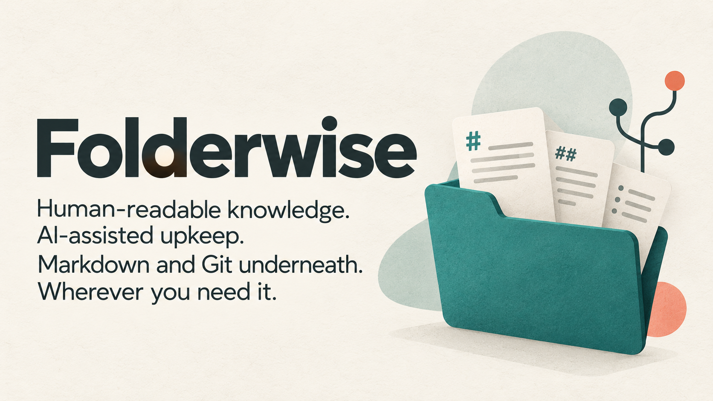
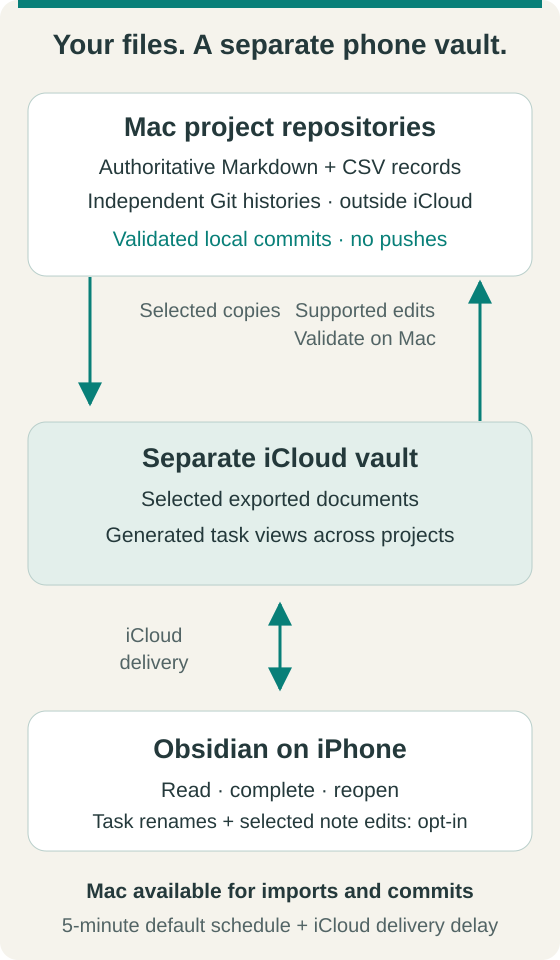
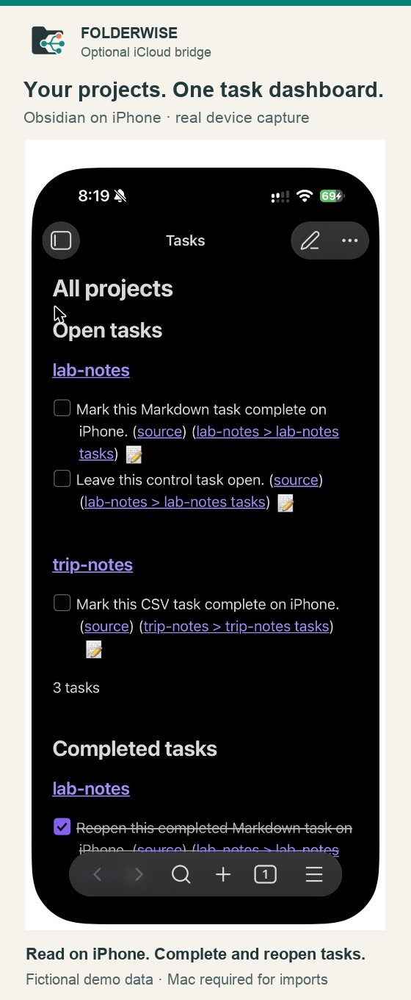
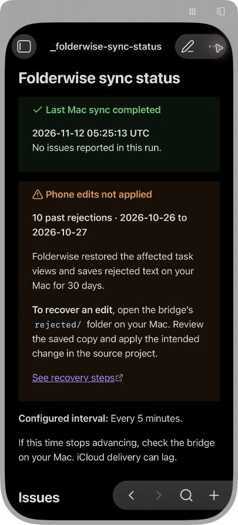
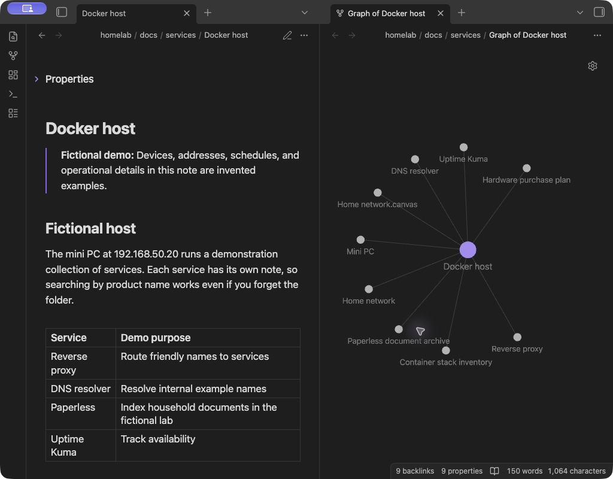

<div align="center">

<h1></h1>

[](#-getting-started)
[](docs/guide.md)
[](LICENSE)
[](https://github.com/TheLinuxGuy/folderwise/actions/workflows/ci.yml)
[](https://codecov.io/gh/TheLinuxGuy/folderwise)
[](https://github.com/TheLinuxGuy/folderwise/releases/latest)

[Overview](#-a-place-for-what-you-know) · [What you get](#-what-you-get) · [Get started](#-getting-started) · [iPhone](#-your-projects-on-iphone) · [Limits](#-privacy-safety-and-limits) · [Docs](docs/guide.md)

</div>

## 📚 A place for what you know

You solved it once. Keep the instructions, the evidence, and the decisions somewhere you can find them again.

**Folderwise** is a Markdown-and-Git framework for knowledge that humans read and AI agents help maintain. Each topic (your personal finances, a home network, cooking recipes, college notes, a technical runbook) gets its own folder and Git history, shared rules for agents, and checks that keep every note dated, attributed and correctly linked. Optionally, read it and tick off tasks from your iPhone.

It is a set of Python scripts and conventions that run on your machine: not an app, a hosted service or an AI model. You, Codex or Claude Code write the notes; Folderwise keeps them consistent and reviewable.

| If you are... | Start here |
|---|---|
| 🗂️ organizing what you know about your personal finances, a system, cooking recipes or college notes | [Getting started](#-getting-started) |
| 🤖 using Claude Code or Codex to write and maintain the docs | [What you get](#-what-you-get) |
| 📱 an Obsidian user who wants your projects on an iPhone | [Your projects on iPhone](#-your-projects-on-iphone) |

<details>
<summary>What a Folderwise document looks like</summary>

```markdown
---
title: NAS inventory
doc_type: inventory
status: active
updated: 2026-11-12
updated_by: claude/sonnet-5-5
last_verified: 2026-11-01
review_every: 90d
---
# NAS inventory

## Change Log
| When                 | By                | Summary        |
|----------------------|-------------------|----------------|
| 2026-11-12 14:05 PST | claude/sonnet-5-5 | Add disk table |
```

Who changed it, when and why, and when someone last checked it against reality. Abridged; fictional example.

</details>

## ✨ What you get

| | What it does |
|---|---|
| 🗂️ **One repo per topic** | `new_project.py` creates a folder with its own Git repository, shared agent rules, a pre-commit hook and a first commit that records the Folderwise version that made it. |
| 🤖 **Agent-ready** | Every project ships `AGENTS.md` (with a `CLAUDE.md` that imports it) and a setup prompt. `--start claude` or `--start codex` opens the agent with the prompt filled in. |
| 🧾 **Accountable edits** | `docs_stamp.py` records who changed a doc (`human`, or an agent and model), when, and what. The `last_verified` date moves only when someone checked the content (`--verified`). |
| ✅ **Checks that fail closed** | The hook validates what is staged: front matter, Change Logs, links and anchors, CSV tables, the index. If the checks cannot run, the commit is blocked. |
| 🔎 **Easy to revisit** | `docs_index.py` lists what exists, `docs_recent.py` what changed, `docs_stale.py` what is due for re-verification, `docs_doctor.py` whether a project is healthy. |
| 🔀 **Safe to reorganize** | `docs_mv.py` moves or renames docs, folders and headings and rewrites the links; `render_tables.py` renders CSV files into Markdown tables. |
| 🔄 **Shared rules stay shared** | `sync_rules.py` pushes the template's rules, hook and config into every project; `--check` shows drift. |
| 📱 **On your iPhone, if you want** | An optional Obsidian + iCloud bridge: read projects, tick tasks, and get supported edits back as [local Git commits](#-your-projects-on-iphone). |
| 🧱 **Framework apart from knowledge** | Your projects are independent repositories the framework ignores, enforced by a guard. Checksummed release archives and pull-only checkouts are supported. |

Everything is plain Markdown, CSV and Git. Every tool, flag and `.docs.yaml` setting is in the [usage guide](docs/guide.md).

## 🚀 Getting started

**Requires:** 🧑‍💻 Git with a configured author identity, 🐍 Python 3.10+, and ⚡ [uv](https://docs.astral.sh/uv/getting-started/installation/).

**Platforms:** 🍎 macOS and 🐧 Linux (CI tests Python 3.10 and 3.15 on Linux and 3.15 on macOS). Native Windows is not supported or tested: the Git hooks are POSIX `sh` scripts, so use WSL.

```sh
git clone https://github.com/TheLinuxGuy/folderwise.git ~/folderwise
cd ~/folderwise
git config core.hooksPath _tools/framework-hooks   # keeps your projects out of the framework's Git index
uv run _tools/new_project.py
```

Choose a topic, describe its purpose, and set its sensitivity. Folderwise creates the project and an agent setup prompt. Give the prompt to Codex or Claude Code (it asks for your context once, proposes three folder structures and waits for your pick), or edit the files yourself. Then work inside the project (example: `homelab-inventory`):

```sh
cd ~/folderwise/homelab-inventory
uv run ../_tools/docs_new.py docs/hosts/nas.md --type inventory --title "NAS inventory" --about "Disks, volumes and shares on the NAS" --by human
uv run ../_tools/docs_stamp.py docs/hosts/nas.md --by human --summary "Add disk table"
uv run ../_tools/docs_lint.py
git add -A && git commit -m "Add NAS inventory"
```

Once a week, across every project:

```sh
cd ~/folderwise
uv run _tools/docs_doctor.py --all
uv run _tools/docs_stale.py --all
uv run _tools/docs_recent.py --all --since 7d
```

Lint checks structure and links, not whether a note is true. A verification date records that someone checked; it does not prove the contents are correct.

> [!TIP]
> You don't need to organize your whole life first. Pick one useful question, such as "How do I recover this service?", and document the answer.

<details>
<summary>Prefer a release archive, or only the framework beside your own repositories?</summary>

- **Release archive:** download from [GitHub Releases](https://github.com/TheLinuxGuy/folderwise/releases) and verify `SHA256SUMS`. [Install steps](docs/framework-checkout.md#install-from-a-release-archive); upgrades [copy framework files with backups](docs/framework-checkout.md#upgrading-an-archive-install). A clone upgrades with `git pull --ff-only`. Upgrades never touch your knowledge projects.
- **Minimal pull-only checkout** (needs Git 2.25+): clone into a new folder, then preview and enable it. It omits public docs, images, CI files and test data, so the `docs/` links on this page then work only online. [Setup and safety checks](docs/framework-checkout.md#minimal-pull-only-checkout).

```sh
cd ~/folderwise
python3 _tools/framework_checkout.py --minimal --dry-run
python3 _tools/framework_checkout.py --minimal
```

</details>

## 📱 Your projects on iPhone

**Read your documents and manage tasks across projects in Obsidian on iPhone, while your Mac stays the owner of every repository.** The iCloud bridge exports selected files to a separate vault; supported phone edits return as validated, local Git commits. Folderwise is a knowledge framework, not an iPhone app: Obsidian provides the phone interface. The bridge is optional and off until you run its setup.

<p align="center">
  <a href="docs/obsidian.md#from-mac-files-to-your-phone"></a>
  <a href="docs/obsidian.md#complete-and-reopen-from-iphone"></a>
  <a href="docs/obsidian.md#bridge-status-report"></a>
</p>

<p align="center"><sub>How it flows · one task dashboard across projects · a sync status you can read on your phone</sub></p>

- **Read and tick.** Selected tracked files are exported, and one `Tasks.md` shows open and completed tasks across projects, each linking to its source. Obsidian Tasks 8.x formats are supported (emoji and Dataview: dates, priorities, statuses, recurrence, IDs and dependencies, nested subtasks). CSV-backed tasks need a project adapter. [Task formats](docs/obsidian.md#task-format-compatibility).
- **Opt in to more.** Rename tasks per project, or edit selected copied notes with both the bridge text-edit switch and project path patterns. Generated task views accept only supported task edits.
- **A local, reviewable history.** The Mac applies an edit only to a clean working tree with no conflicting Mac-side change, runs the project's checks, and commits locally. It never pushes to GitHub.
- **Mistakes are contained, and you can see it.** A rejected edit is restored and its text saved on the Mac for 30 days. The [sync status note](docs/obsidian.md#bridge-status-report) on your phone shows when the Mac last synced, any issues, and how to [recover](docs/obsidian.md#conflicts-and-recovery) a rejected edit.

```sh
cd ~/folderwise
uv run _tools/icloud_bridge.py setup --icloud --dry-run   # preview
uv run _tools/icloud_bridge.py setup --icloud
```

That creates the iCloud vault, installs checksum-verified Tasks and Dataview releases, and schedules the Mac job. Open the vault in Obsidian and allow community plugins. **[Quick Start →](docs/obsidian.md#quick-start)**

> [!IMPORTANT]
> **Know before you start**
> - **Setup enrolls every existing project that has no explicit choice,** including any marked `restricted`, and new projects join by default. `sensitivity` is not an export filter. The vault holds copies of tracked files, and they travel through Apple's iCloud. Preview with `--dry-run`, and opt a project out with `icloud_bridge.py disable`.
> - **Needs** a Mac that stays logged in, Obsidian 1.13.1 or later, iCloud Drive on both devices, and **Keep Downloaded** set by you in Finder on the whole vault; setup does not do it ([why and how](docs/obsidian.md#required-keep-the-entire-vault-downloaded-on-the-mac)).
> - **Not real time.** Default: every five minutes plus iCloud delivery time, with a 120-second quiet period for text edits.
> - **Unsupported:** Android and native Windows. Folderwise runs no sync service.

**How well is it tested?** Self-tests with a simulated iCloud run on every change. One recorded acceptance run used a real iPhone and Mac with fictional data: 88 checks, 85 passed, 3 blocked, none failed ([record](docs/ibridge-acceptance-0.2.0.md), [checklist](docs/ibridge-testing.md)). The blocked ones, not validated on a device, are edits made offline then reconnected, Tasks loading in a brand-new phone vault, and a visible notification banner. That run predates one-command `setup --icloud` and the redesigned sync status note, which are covered by the self-tests.

<details>
<summary>Browse your knowledge on the desktop, too</summary>

<p align="center">
  
</p>

Obsidian demo with fictional notes. Cross-project links shown are demo-only; Folderwise currently validates links within each repository. [Understand the repository layout](docs/framework-checkout.md).

</details>

## 🔒 Privacy, safety and limits

- 🏠 **Local first.** Your notes live in your own Git repositories. Optional iCloud export is user-configured, and the bridge never pushes to GitHub.
- 🚧 **Guarded framework repository.** Its Git index is an allowlist, and a guard rejects knowledge projects, secrets, caches, symlinks and nested repositories before they can be committed. It checks paths, not meaning: review diffs before publishing, and never put passwords or tokens in documents.
- 🤖 **Agent permission defaults are not a security boundary.** Review the shipped settings before using an agent.
- ✍️ **One writer at a time.** Keep source repositories outside iCloud, and edit each from one machine at a time.

## 📖 Learn more

[Usage guide](docs/guide.md) (every command, flag and setting) · [Obsidian + iCloud guide](docs/obsidian.md) · [Framework checkout and upgrades](docs/framework-checkout.md) · [Bridge acceptance checklist](docs/ibridge-testing.md) · [Release notes](https://github.com/TheLinuxGuy/folderwise/releases): what changed in each version

## 🤝 Contributing

Contributions are welcome; open an issue to discuss larger changes, and keep examples fictional. Run `uv run _tools/selftest.py` before and after your change. A changed command, setting or behavior needs a self-test and a documentation update, and CI requires 85% production line coverage and 90% coverage of changed lines. See [CONTRIBUTING.md](CONTRIBUTING.md); maintainers: [release and CI guide](docs/maintainers.md).
