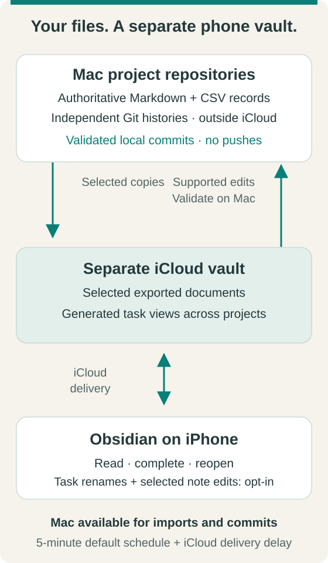
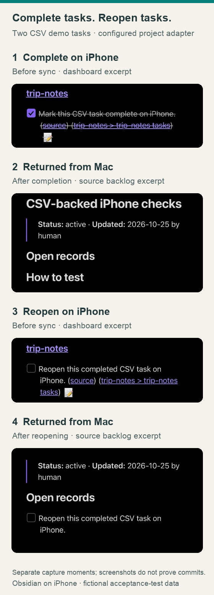
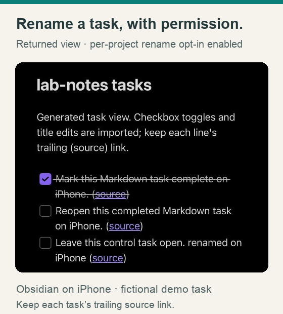
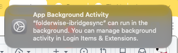
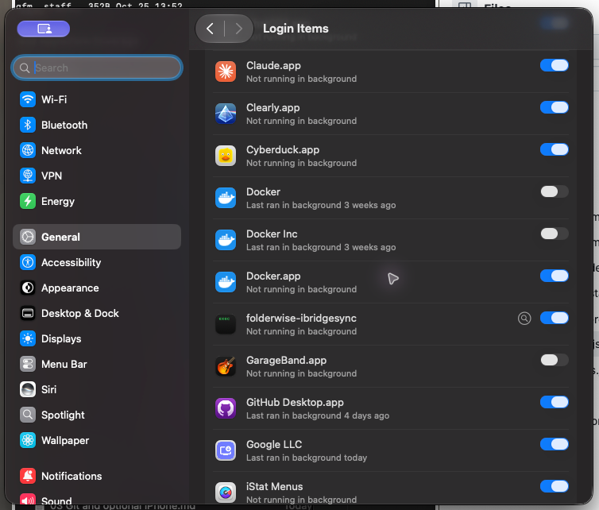
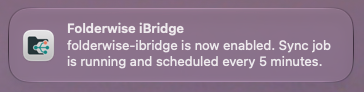
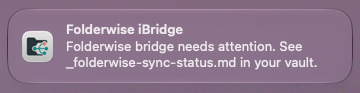

# Use Folderwise with Obsidian, iCloud, and iPhone

The optional **folderwise-ibridge** keeps your project repositories on your Mac and exports a separate Obsidian vault into iCloud. Read your documents and complete tasks from one dashboard on iPhone. One Mac imports checkbox changes, updates authoritative records, regenerates views, stamps documents, validates them, and creates local Git commits in each project.

The bridge is deliberately simple: checking means complete; unchecking means incomplete. It does **not** interpret a task, confirm evidence, or establish that the described action happened. Task changes do not advance `last_verified`. Project adapters must implement this same boolean behavior without fabricating evidence. A project can additionally accept task **renames** from the phone; see [Rename tasks from iPhone](#rename-tasks-from-iphone-opt-in). Selected notes can accept **text edits** too; see [Edit notes from iPhone](#edit-notes-from-iphone-opt-in).

## Quick Start

Goal: tick a task in Obsidian on your iPhone and watch it become a local, reviewable Git commit on your Mac, in about five minutes plus iCloud delivery time. Use fictional data first.

### Prerequisites

* A Mac that stays logged in: the scheduled job is a macOS LaunchAgent. Linux can run foreground-only with `--no-schedule`; Windows and Android are unsupported.
* Python 3.10+, [uv](https://docs.astral.sh/uv/getting-started/installation/) and Git with a configured author identity.
* A Folderwise checkout (see [Getting started](../README.md#-getting-started)) with at least one project whose files are committed; only tracked files are exported.
* An iPhone and the Mac on the same Apple account with iCloud Drive on, and the Obsidian app on the iPhone (validated: Obsidian 1.14.5, iOS 27.0.1).
* The community **Tasks** plugin in Obsidian (validated: 8.6.0), installed from Obsidian's own plugin browser; it is not bundled. Dataview is optional.

### 1. Installation / Setup

```sh
cd ~/folderwise                         # your Folderwise checkout
VAULT="$HOME/Library/Mobile Documents/iCloud~md~obsidian/Documents/Folderwise"
uv run _tools/icloud_bridge.py setup --source ~/folderwise --vault "$VAULT" --dry-run   # preview; changes nothing
uv run _tools/icloud_bridge.py setup --source ~/folderwise --vault "$VAULT"             # export, enroll projects, first sync, register schedule
```

Setup enrolls every existing project that has no explicit setting (commit pending edits in them first) and makes future `new_project.py` projects join by default. See [Explicit setup](#explicit-setup-and-reusable-vault-defaults) for what it writes and [Uninstall](#uninstall-or-remove-the-supplied-defaults) to undo it.

### 2. Run the Main Feature

```sh
uv run _tools/icloud_bridge.py status    # last_run.ok is true and schedule.enabled is true
uv run _tools/icloud_bridge.py doctor    # prints "OK ..." and exits 0
uv run _tools/icloud_bridge.py plan      # optional: read-only preview of any pending phone edit
git -C ~/folderwise/my-project log -3 --format='%h %s'   # one of your projects
```

* **On the iPhone:** open the iCloud vault `Folderwise` in Obsidian, turn off Restricted mode, enable **Tasks**, open `Tasks.md` in reading mode and tick one open task.
* **Wait** for iCloud delivery and the next scheduled run (up to the interval plus delivery time). Do not run `sync` by hand.
* **Confirm the commit:** the project's `git log` shows `Update task completion from Obsidian` with the trailers `Bridge: folderwise-ibridge` and `Bridge-Ops: toggle=1 rename=0`. The task is now checked in the source note, and `_folderwise-sync-status.md` in the vault lists the commit under **Recent imports**. Nothing is pushed.

### 3. Key Configuration Knobs

| Parameter / Flag | Default | Description |
| :--- | :--- | :--- |
| `configure --interval-minutes N` | `5` | Scheduled run interval. Run `schedule-enable` afterwards to reload the job. |
| `configure --edit-settle-seconds N` | `120` | Quiet period: edited text must stay unchanged this long (across two runs) before it is imported; plain checkbox toggles import immediately. |
| `configure --notifications MODE` | `errors` | `off`, `errors` (alerts only) or `imports` (also a counts-only note per run that applied phone edits). |
| `folderwise-ibridgerename: true` in a project's `.docs.yaml`; `configure --text-edits on` plus `folderwise-ibridgeedit` patterns | off | Per-project opt-in to rename tasks from the phone; bridge-wide switch plus per-project note patterns to edit copied notes. |

Next: [how tasks round trip](#complete-and-reopen-from-iphone), [supported task formats](#task-format-compatibility), [rename](#rename-tasks-from-iphone-opt-in) and [note edits](#edit-notes-from-iphone-opt-in), [CSV adapters](#authoritative-csvs-and-project-adapters), [conflicts and recovery](#conflicts-and-recovery), and the [real-iPhone acceptance record](ibridge-acceptance-0.2.0.md).

## From Mac files to your phone

Folderwise is a Markdown-and-Git knowledge framework, not a standalone iPhone app. **Obsidian** provides the phone interface; the optional bridge connects selected exports to your local repositories. Folderwise provides no hosted sync service.

<p align="center">
  
</p>

The Mac must be available for imports and local commits. Scheduled sync defaults to **five minutes**, with additional iCloud delivery delay; this is not instant or real-time sync. Selected-note edits also wait for their quiet period. Imports require a clean project working tree, validation and conflict checks. Local commits do not imply GitHub pushes.

| On iPhone | What is supported |
| --- | --- |
| Read documents | Selected tracked files exported into the separate vault |
| Complete or reopen a task | Checkbox toggles in generated task views or supported handwritten source checkboxes; CSV tasks need a configured adapter |
| Rename a task | Per-project `folderwise-ibridgerename: true`; edit the generated task view and preserve its source link; adapter tasks must permit title edits |
| Edit selected copied notes | Bridge `--text-edits on` **and** project `folderwise-ibridgeedit` patterns; protected regions, quiet period and conflict rules still apply |

Generated task views have stricter rules than opted-in copied notes: they are task projections, not free-form documents. The screenshots below illustrate task operations, **not selected-note text editing**.

## Layout and prerequisites

Use one vault for all project folders. Your source parent remains outside iCloud, for example `~/folderwise/`, with independent project repositories underneath. Create a **separate** vault in Obsidian under `iCloud Drive/Obsidian/Folderwise`. Do not move the source repositories, put Git history in the vault, or synchronize that vault with a second cloud service.

Use the same Apple account on Mac and iPhone and enable iCloud Drive. Keep the Mac vault downloaded. Obsidian's [official sync guide](https://help.obsidian.md/sync-notes) covers device setup. The bridge cannot force iCloud to deliver a change immediately or prove another device received it.

The Mac needs Git, uv, the Folderwise tools, a configured Git author, and an active login session for scheduled operation. Only committed, tracked project files are eligible for export; commit new documents on Mac before expecting them on iPhone. Never commit credentials merely to make them eligible. Existing source edits can be read, but pending phone imports wait until that project's working tree and index are clean.

## Explicit setup and reusable vault defaults

Obsidian is **off by default**. A fresh clone does not create `.obsidian/`, start a bridge job, or enable new projects for export. Choose a parent source directory outside iCloud and a separate destination under `iCloud Drive/Obsidian/`. The script initializes both as vault folders; open the iCloud vault in Obsidian on your devices afterward. Use fictional data for the first test.

Preview the complete setup, then run it (replace these fictional paths as needed):

```sh
uv run _tools/icloud_bridge.py setup --source ~/folderwise --vault "$HOME/Library/Mobile Documents/iCloud~md~obsidian/Documents/Folderwise" --dry-run
uv run _tools/icloud_bridge.py setup --source ~/folderwise --vault "$HOME/Library/Mobile Documents/iCloud~md~obsidian/Documents/Folderwise"
```

Setup creates the local parent vault alongside your project folders and a separate iCloud vault, installs missing settings, enrolls existing unconfigured projects, records the default for future projects, runs the initial sync, and registers the macOS schedule. `--no-schedule` performs setup and foreground sync without registering a job; use it on non-Mac systems and in test sandboxes. The setup notification announces the configured interval after the job is registered. `setup --dry-run` previews eligible files, estimated bytes, omissions and project enrollment without changing vaults, project flags or future-project defaults.

The framework ships reviewed defaults in `_tools/obsidian_defaults/`, not a live `.obsidian/` directory:

| Defaults | Behavior |
| --- | --- |
| `app.json` | Relative Markdown links, no automatic link renames, reading view and no duplicate inline title |
| `appearance.json` and snippet | Default theme, readable font and tabular numerals in tables |
| `core-plugins.json` | Search, graph, backlinks, outline, properties, Bases and recovery; competing sync/publish disabled |
| `graph.json` | General navigation settings without private project names or demo color groups |
| `types.json` | Shared document property types, without demo query fields |
| `community-plugins.json` and plugin settings | Tasks/Dataview IDs; automatic task dates and Dataview JavaScript disabled |

**Community-plugin binaries are not bundled or downloaded.** Install Tasks and optional Dataview through Obsidian's community-plugin browser, then enable them. Setup seeds their settings; it does not bypass Obsidian's Restricted mode. See [Obsidian's community-plugin guide](https://help.obsidian.md/community-plugins). Device-specific `workspace.json`, caches and installed plugin code are never copied from the demo.

Existing setting files are preserved in full. If you already have Tasks settings, confirm automatic dates are off; setup does not replace your preferences. `vault-init` fills missing defaults later without overwriting customization. Vaults become available when opened in Obsidian; the helper does not edit Obsidian's global vault registry.

Configuration, ownership records, baselines, temporary clones, export journal and logs stay outside iCloud. On Mac the default state directory is `~/Library/Application Support/Folderwise/ibridge/`. A private `.folderwise-obsidian.json` at the source root records whether the integration is enabled and points to that configuration. `new_project.py` reads it in each new process. Neither file is committed to the framework. Use `--config /absolute/path/config.json` before a bridge command for another private installation. Keep recovery state: deleting it removes knowledge of pending edits and owned files. Source, vault and state directories must remain separate.

`plan` previews ordinary export/cleanup and any pending phone edits (`PHONE EDIT alpha: would toggle 1 and rename 0 task(s)`, or `PHONE EDIT REJECTED …` with the reason); `sync` performs a foreground run. Neither recreates removed Obsidian settings, and `plan` changes nothing. New or missing defaults are installed only through explicit setup or `vault-init`.

## Central task dashboard

In Obsidian on Mac and iPhone, install and enable the community **Tasks** plugin (`obsidian-tasks-plugin`). Open the exported root `Tasks.md` in reading mode. It includes open and completed tasks across all enabled projects, grouped by project. Every result links to its source document. Undated and nested tasks are included; no tag is required. Tasks inside fenced code examples, front matter and generated blocks are excluded from generic Markdown scanning.

### Complete and reopen from iPhone

Tick a task in `Tasks.md` to complete it. Untick it in **Completed tasks** to reopen it, including an adapter-backed row hidden by the project's normal backlog. Let iCloud deliver the edit and the Mac run the next scheduled import; then check the returned source note and **Recent imports** in `_folderwise-sync-status.md`.

<p align="center">
  
</p>

*Real-device acceptance captures with fictional data and a configured CSV adapter. These show two different demo tasks: one completed and another reopened. Panels 1 and 3 are phone state before sync; panels 2 and 4 are returned source views after sync. Screenshots support the visual sequence; verify local commits separately with the [acceptance checklist](ibridge-testing.md#2-complete-tasks-from-the-dashboard). They do not independently establish Git history or selected-note editing.*

### Generated task folder and naming

`TASK_DIR` is the tool’s internal constant for **`_Folderwise Tasks`**, a bridge-managed folder at the root of the **iCloud vault**. It is not a folder in your authoritative Mac project repositories. The bridge builds one task-view file per enabled project, combining its supported handwritten Markdown checkboxes and tasks supplied by its configured CSV adapter.

The naming convention is **`_Folderwise Tasks/<project-folder-name>.md`**: the filename exactly matches the project directory name, followed by `.md`. For example:

```text
Folderwise/                         # iCloud Obsidian vault
├── Tasks.md                        # central dashboard: open and completed queries
├── _folderwise-sync-status.md      # generated sync issues and storage report
├── _Folderwise Tasks/
│   ├── finances.md                 # task view for the finances project
│   └── home-lab.md                 # task view for the home-lab project
├── finances/                       # selected copies of project documents
└── home-lab/
```

These names are fixed by the bridge, not user-configurable settings. Each generated file has a project heading and ordinary `- [ ]` / `- [x]` task lines with links to the copied source documents. Completed tasks remain available for reopening, including completed rows returned by an adapter even if the project’s normal backlog hides them. `Tasks.md` queries only `_Folderwise Tasks`, avoiding duplicate results from copied source notes. [Tasks queries can update their source checkboxes](https://publish.obsidian.md/tasks/Introduction).

On each scheduled or manual `sync`, the bridge:

1. Compares checkbox changes in the previous generated views with its local task mappings.
2. Applies those boolean changes to authoritative Mac Markdown or adapter-managed records, regenerates affected source views, validates, and commits local changes.
3. Rebuilds the project task views and dashboard from the current Mac sources. It writes files only when content changes. New projects join when enabled; disabling a project removes its unchanged generated task-view file after pending phone changes are resolved.

To refresh immediately, run `uv run _tools/icloud_bridge.py sync` on the Mac. The scheduled job performs the same operation at your configured interval.

**Use the Tasks controls to edit tasks; keep each task’s source link, and do not reorder rows or rename the generated files/folder.** Checkboxes, configured statuses and task metadata are imported; description edits need the per-project opt-in below. Textual edits and temporary malformed saves wait for the quiet period before import or rejection. Tasks-generated recurrence rows and explicit completion deletion are supported as described below. If you make any other edit to a generated task view, the bridge saves your exact text on the Mac (outside iCloud, kept 30 days), restores the view from Mac data on the next sync, lists the edit under **Phone edits not applied** in `_folderwise-sync-status.md`, and sends one notification. Unsupported edits to a copied source note are different: they stay in the vault and pause that project so they cannot be overwritten (see [Conflicts and recovery](#conflicts-and-recovery)). Missing generated files are restored from Mac data on the next sync. Task identity and ownership mappings live in the bridge’s local state outside iCloud; the generated Markdown is an interactive view, not the authoritative task store.

### Task format compatibility

The compatibility reference is **Obsidian Tasks 8.6.0**, upstream commit `6c7e9a1443e645f29998619974329b61cd2d52dd`. The controls shown by the iPhone app come from this community plugin. Source: [Tasks suggestor and serializers](https://github.com/obsidian-tasks-group/obsidian-tasks/tree/6c7e9a1443e645f29998619974329b61cd2d52dd/src). `ibridge_tasks.py` is the bridge's internal field/projection helper, not a separate command.

| Operation | Supported behavior |
| --- | --- |
| Due/start/scheduled dates | `📅` (also `📆`, `🗓`), `🛫`, `⏳` (also `⌛`), followed by a valid `YYYY-MM-DD`; emoji variation selectors are accepted |
| Priorities | Highest `🔺`, high `⏫`, medium `🔼`, low `🔽`, lowest `⏬`; removing the field restores normal priority |
| Lifecycle dates | Created `➕`, done `✅`, cancelled `❌`; automatic dates may be enabled for handwritten tasks. Reopening clears a stale done date |
| Other metadata | Recurrence `🔁`, task ID `🆔`, dependencies `⛔`, on-completion `🏁 keep` / `🏁 delete`, tags and final `^block-id` |
| Dataview format | Square or parenthesized inline fields: `[due:: ...]`, `[start:: ...]`, `[scheduled:: ...]`, `[created:: ...]`, `[completion:: ...]`, `[cancelled:: ...]`, `[priority:: high]`, `[repeat:: ...]`, `[id:: ...]`, `[dependsOn:: ...]`, `[onCompletion:: ...]` |
| Custom statuses | The original character is retained. The iCloud vault's Tasks `statusSettings` defines its type; space/x/X, in-progress `/` and cancelled `-` have defaults. Unknown statuses require configuration before importing them through generated views |
| Subtasks | Spaces/tabs, `-`, `*`, `+`, numbered `1.`/`1)` tasks, quoted/callout `>` prefixes, non-task list parents and indented continuation text are preserved. Parent and child checkboxes are independent |
| Recurrence | Tasks calculates the next dates and supplies the next/completed rows. The bridge validates the matching identities, repeat rule and description, then imports both in one transaction. Replaying an unchanged save creates no extra occurrence, including recovery after a source commit was published before its export-state update. The bridge does not calculate recurrence when a plain Markdown checkbox is toggled without the plugin. Finite/count-limited schedules inherit the upstream plugin’s documented limitations |
| On-completion deletion | Removing a row is accepted only when its existing authoritative task explicitly contains `🏁 delete` or `[onCompletion:: delete]`. This authorizes deletion of that task line; unrelated lines and source documents are retained. Recurring deletion keeps the plugin's next occurrence |

Generated source links include a stable `fw:` link title for row ownership. Keep that link intact. Generated Tasks IDs and dependencies use the reserved `fwview-` prefix so they do not collide with IDs indexed from copied source notes; imports remove that projection prefix. Source IDs should remain globally unique across the vault. The source link belongs **after the description and before metadata**, allowing Tasks to recognize the trailing fields. Plugin serialization may reorder fields; edits to independent metadata fields merge with Mac changes, while disagreements on the same field require review. Description renames preserve metadata. Metadata-only edits preserve source links/images; changing the description of a linked task requires a Mac edit or the copied-note text-edit opt-in. Unknown inline fields remain ordinary description text.

Generated-view text edits (including automatic date insertion), structural recurrence edits and malformed intermediate saves wait for `edit_settle_seconds` (default 120 seconds across runs). Simple checkbox/status-only changes import immediately. While a generated view is settling, other imports/exports for that project wait with it, preserving a consistent baseline; healthy projects continue. A value of zero explicitly disables generated-view settling. Copied-note text edits still require two observations. Recent-import counts include field updates, recurrence and deletion. Each imported note gets a distinct Change Log fingerprint, including repeated edits within the same second. Files are rechecked before publication; a concurrent phone save aborts the local import and remains pending.

Handwritten task checkboxes and metadata may also be edited in copied source documents. Broader text edits, new task lines, child creation/deletion/reparenting and plugin recurrence inside a copied note require the note-edit opt-in below. Generated blocks stay protected and adapter-managed records must use mapped views. Creating arbitrary tasks, moving/reordering generated rows, phone-created documents, source file deletions/renames and attachment imports remain unsupported. Missing exported files are restored from Mac; phone file deletion never deletes a source document.

Run `doctor` after setup or plugin upgrades. It reports the installed Tasks version, serialization format and custom status types, warns about a non-empty global filter or a version outside the compatibility fixtures, and does not overwrite user settings. Existing settings are retained. Fresh defaults keep automatic lifecycle dates off for compatibility with boolean-only adapters; enable them only when the relevant adapters advertise date support. Dataview remains optional. Its inline-field metadata format is supported and was exercised on a real iPhone through the Tasks plugin's Dataview format ([acceptance row 2.7](ibridge-acceptance-0.2.0.md#2-dates-and-priorities)); no acceptance row exercises Dataview's own query engine.

An upgrade accepts pending schema-2 edits when their source identity can be verified against the exact source snapshot. Ambiguous or concurrently changed old mappings require review and retain the phone text. See [the release acceptance checklist](ibridge-testing.md) before using production data; passing CLI fixtures does not certify actual iCloud delivery or an iPhone app version. The 0.2.0 real-iPhone results, and how to reproduce them, are in the [acceptance record](ibridge-acceptance-0.2.0.md).

### Rename tasks from iPhone (opt-in)

Renaming is off by default. To allow it for a project, add this to its `.docs.yaml` and commit it:

```yaml
folderwise-ibridgerename: true
```

<p align="center">
  
</p>

*Authentic returned task-view excerpt with fictional data. This shows the renamed title on the phone; the [rename acceptance test](ibridge-testing.md#5-opt-in-rename-test) verifies the source, local commit and status entry separately.*

The value must be a boolean. After the next sync the project's generated view says that title edits are imported. Then, on iPhone:

1. Open `_Folderwise Tasks/<project>.md` and edit the task text, or use the Tasks plugin's edit dialog on `Tasks.md` and change the description. Keep the checkbox and the complete `([source](…))` link after the description. Dates, priorities and other metadata belong after that link; a block ID stays last.
2. After the text has settled across scheduled runs the Mac validates the edit, applies it in an isolated clone, stamps the changed note as `human`, lints and commits locally. The commit message records counts and `Bridge-Ops: toggle=N rename=M`, never the titles, and states that titles are user-typed and unverified. The Change Log row says "Rename tasks via Obsidian iCloud bridge". `last_verified` is not advanced.
3. The regenerated view shows the new title and the status report lists the import under **Recent imports**. You can rename and toggle the same task in one save; both are applied in one commit.

A rename is accepted only when all of these hold. Otherwise the whole save of that view is rejected: the text is saved on the Mac, the view is restored, and the reason is listed in the status report.

| Rule | Why |
| --- | --- |
| One line, 1–200 characters, no control or text-direction characters | Keeps the note and its generated blocks intact |
| No `<!--`, no `-->`, no `([source](`, no leading `[ ]`, and no leading `=`, `+`, `-` or `@` | Prevents forged markers, nested lists and spreadsheet formulas |
| No links or images in the new title, and the task's current title must not contain any | The view shows links as plain text, so renaming it would silently drop them; edit those tasks on the Mac |
| The new title may not equal another task's title in the same view | Stops swapped or reordered lines from being read as renames |
| Tasks that share a title with another task cannot be renamed | Their identity depends on position |
| The task must be unchanged on the Mac since the last export | A rename never overwrites a Mac-side change |
| Adapter tasks must advertise `editable: ["title"]` | Only the project's adapter knows how to rewrite its records |

Description edits inside copied source notes require the separate note-edit opt-in below; generated views use the rename opt-in.

### Edit notes from iPhone (opt-in)

A copied Markdown note can accept text edits from the phone. This is **off twice over**: the bridge must have the switch on, and each project must list which notes may be edited.

```sh
uv run _tools/icloud_bridge.py configure --text-edits on      # bridge-wide switch (default off)
uv run _tools/icloud_bridge.py configure --edit-settle-seconds 120   # quiet period, default 120
```

```yaml
# the project's .docs.yaml (commit it); `*` stays inside a folder, `**` crosses folders
folderwise-ibridgeedit:
  - "docs/notes*.md"
  - "journal/**/*.md"
```

Patterns are project-relative paths; they may not start with `/` or contain `..`, and only `.md` files can match. On the phone, edit the note's text in Obsidian as usual. Then:

1. The Mac waits for a **quiet period**: the note's exact text must stay unchanged across two scheduled runs and for at least `edit_settle_seconds`, so half-typed sentences are never committed. While it waits the vault copy is left exactly as you saved it and `plan` shows `PHONE EDIT WAITING`.
2. If the Mac copy is unchanged since it was last exported (a fast-forward), the bridge writes your text into an isolated clone, stamps the note as `human` ("Edit notes via Obsidian iCloud bridge"), runs project lint and the project's hooks, and commits locally. The commit message records counts and `Bridge-Ops: … text-edit=N` and says the text is user-typed and unverified; it never contains the note's text. `last_verified` is not advanced.
3. The vault copy is then replaced by the stamped note, with its new Change Log row, and the status report lists the commit under **Recent imports** (*Edited* column).

What the bridge protects and refuses (the project pauses and names the note; nothing is lost):

| Edit | Result |
| --- | --- |
| Front matter changed in meaning | Refused; the Mac stamps it. Reformatting by Obsidian's Properties editor that leaves the values identical is ignored and the Mac's formatting is kept |
| Byline, table of contents, Change Log, tables, task blocks or any other `<!-- name:start -->` … `<!-- name:end -->` block changed, or such a marker added | Refused |
| A copy saved from an older export | Refused, because its Change Log differs from the Mac's; newer Mac text is never undone |
| More than 200 changed lines, more than half the note removed, an emptied note, over 256 KB or 5,000 lines, or NUL bytes | Refused |
| Edit fails the project's lint or hooks (for example a broken link) | The Mac note stays unchanged; the error is shown |
| The note also changed on the Mac since its last export | Paused: the Mac version stays; use `resolve` to keep it, or merge by hand |
| A task in the same note was edited in a generated view in the same run | Paused until one of the two is resolved |
| Notes not matching a pattern, new files, deletions, renames, CSV files and attachments | Not imported |

Checkbox toggles inside an editable note still import as ordinary task changes. Windows-style (CRLF) notes keep their line endings. Text typed on the phone enters your repository and may later be read by people or agents, so keep the pattern list narrow, review the commits, and never list notes holding instructions you rely on. A compromised phone or Obsidian plugin can only reach the notes you list, and every change is a local Git commit you can revert.

## Authoritative CSVs and project adapters

A framework cannot infer arbitrary CSV schemas. Register a project-owned adapter when checkboxes come from generated records. Without one, the status report explicitly identifies generated task sources that are not yet included in the interactive dashboard. Do not claim those tasks are synchronized until their adapter is configured and tested.

A private bridge config can contain:

```json
{
  "adapters": {
    "homelab-inventory": ["python3", "scripts/ibridge_adapter.py"]
  }
}
```

This is an excerpt, not a replacement for the complete generated config. Adapter commands are argv arrays in trusted **Mac configuration**, never executable instructions read from the iCloud vault. Relative script paths resolve inside the project. Commands receive one operation argument:

| Operation | Contract |
| --- | --- |
| `list` | Print a JSON array of `{id, title, path, checked}` objects; IDs are unique and stable, `checked` is boolean, `path` is an existing project-relative document. Include completed records. A task may add `editable: ["title"]` to allow phone renames when the project has `folderwise-ibridgerename: true`. |
| `apply` | Read a JSON array of `{id, checked}` requests on stdin; update authoritative sources and regenerate every affected view. Preserve unrelated records. `checked` is always present. A rename also carries `title` and `expected_title`: compare `expected_title` with the record and fail if it changed. After `apply`, the bridge re-lists and requires the requested `checked` and `title` values. |
| `validate` | Exit zero only when authoritative data and regenerated views agree. No task-semantic or evidence approval gate. |

[Example CSV adapter](examples/ibridge_csv_adapter.py) demonstrates an open/complete CSV and a generated backlog that hides completed tasks. Copy it into a fictional project first, adapt its schema and renderer, and commit it with the project. Its unchecked state is explicitly `open`; map richer statuses such as blocked/cancelled deliberately. An adapter task must live in a generated block rather than also appearing as a handwritten task, to avoid two independent identities for the same record.

Adapters remain backward compatible with `{id, checked}`. Rich adapters add field names to `editable`: `due`, `start`, `scheduled`, `created`, `done`, `cancelled`, `priority`, `repeat`, `id`, `dependsOn`, `onCompletion`, `block`, plus `status`, `recurrence` and `delete` capabilities. `title` authorizes description edits. An unsupported field is rejected by name; it is never silently appended to a boolean adapter's record.

A field edit carries the complete new `title`, `expected_title`, a `fields` object of changed semantic values (null removes a field), and `expected_fields`. The adapter must compare the expected state, write its authoritative records, and regenerate views. A custom state carries `status`. Recurrence carries `recurrence: [{title, status}, ...]`: update the original completed record and create exactly one new stable-ID record for the open occurrence. Deletion carries `delete: true` and `expected_title`; it requires the authoritative task's explicit on-completion action. The bridge re-lists and validates requested titles/statuses, the created occurrence and deletion before publishing. Adapters must advertise only operations their data schema can faithfully represent.

Adapters run in a temporary local Git clone with the project's hooks, not directly against your source working tree. The bridge applies requests, stamps changed Markdown as `human`, runs adapter validation, Folderwise lint and commit hooks, then fast-forwards the clean source repository. It never pushes. Failed validation or hooks leave source records unchanged and phone toggles pending. Local transaction work needs disk space for a project checkout; Git objects are shared with the source rather than duplicating its history. Adapters must use project-relative paths and must not write outside their working directory. Custom Git hook paths are not supported; use the project's standard `.git/hooks` directory.

Handwritten tasks use file/text identity plus duplicate occurrence. Line shifts alone do not identify a task. If identical task text occurs more than once and that source file changes concurrently, the bridge stops for review rather than guessing which duplicate moved. Changed task text or a source rename can also require review.

## Project participation and persistent creation defaults

The positive `.docs.yaml` key is **`folderwise-ibridgesync`**. True enables participation; false or a missing key disables it. A fresh installation omits the key and creates no vault settings. Running setup opts into this integration, including eligible restricted content; the project's `sensitivity` is not an upload filter.

Setup enables existing projects with no explicit setting and preserves existing true/false choices. Each enrollment is committed through an isolated local clone and its normal hooks. Commit existing source edits first; setup will not mix them into an enrollment commit. An interrupted setup can be retried, and a failed setup does not enable the future-project default.

After successful setup, **every new `new_project.py` project writes `folderwise-ibridgesync: true`**, including from another terminal or agent process. Override that default for one project with:

```sh
uv run _tools/new_project.py --name offline-notes --description "Local-only notes" --icloud-disabled
```

This flag writes `folderwise-ibridgesync: false`, even before global setup, so a later setup respects that deliberate opt-out. Change an existing project's choice with:

```sh
uv run _tools/icloud_bridge.py disable homelab-inventory
uv run _tools/icloud_bridge.py enable homelab-inventory
```

The helpers update only that project's setting; commit it when ready. They do not change the default for future projects. Disabling removes only unchanged bridge-owned exported copies on the next sync. Pending phone edits block cleanup: re-enable, import or preserve those edits, then disable again.

### Uninstall or remove the supplied defaults

```sh
uv run _tools/icloud_bridge.py uninstall
```

Uninstall stops the owned schedule, disables the integration, removes the private creation-default profile, and deletes only unchanged settings installed by setup. Customized settings, workspace layouts, downloaded plugins, source documents, exported documents, explicit project flags and recovery state are preserved. A vault may therefore retain user-owned `.obsidian/` files. **Projects created after uninstall default to sync disabled again.** Re-running setup restores the opt-in lifecycle and preserves previous bridge configuration.

The existing framework checkout helper can do this in the same operation as removing README.md:

```sh
python3 _tools/framework_checkout.py --minimal --omit README.md --remove-obsidian --dry-run
python3 _tools/framework_checkout.py --minimal --omit README.md --remove-obsidian
```

`--remove-obsidian` uninstalls the configured integration and removes unchanged generated defaults; it does not delete reusable assets from the framework or remove user content. Normal `--minimal`, `--update` and `--omit README.md` operations leave the optional integration alone unless this flag is supplied.

## Full, lean, and image limits

Full mode is the default and all limits are unlimited. It exports eligible tracked project content. Both modes exclude hidden/control files, Git history, agent instructions, private keys, caches, nested repositories, and symlinks. Exclusions are a practical filter, not a content classifier: review `plan` before uploading private data.

Lean mode exports Markdown and locally referenced images only. Rendered Markdown tables remain readable without exporting their CSV inputs. References must resolve inside their own project; external image URLs are not downloaded. Markdown image embeds, reference-style images, and unambiguous Obsidian image embeds are supported. Other attachments such as PDFs remain excluded in lean mode; their links may be unavailable on iPhone.

```sh
uv run _tools/icloud_bridge.py configure --mode lean
uv run _tools/icloud_bridge.py configure --max-image-bytes 5242880 --max-images-total-bytes 104857600
uv run _tools/icloud_bridge.py plan
uv run _tools/icloud_bridge.py sync
uv run _tools/icloud_bridge.py configure --unlimited-images
uv run _tools/icloud_bridge.py configure --mode full
```

Limits apply to individual images and all selected images across enabled projects. `null` means unlimited; `0` means zero bytes. Markdown/tasks are never omitted to satisfy an image limit. Selection is deterministic in project/path order: reject oversized files, include images that fit, skip one that does not fit and continue to smaller later images. Repeated references to the same path count once. Original image bytes and document references are preserved.

### Bridge status report

The generated `_folderwise-sync-status.md` lives at the root of your iCloud vault. It lists sync issues and gives you details to investigate a notification. After a phone edit is imported or rejected it also shows up to ten recent entries, each kept 30 days: **Phone edits not applied** (when, file, reason, with line numbers; the exact text is saved on the Mac), **Recent imports** (when, project, local commit, toggles and renames), and **iCloud conflict copies** (files such as `note 2.md` created beside a managed file; they are reported and never imported, so compare each with its original and delete the one you do not want). The sections appear only when there is something to show. On upgrade, the bridge replaces an unchanged, bridge-owned `Bridge Status.md` with this name. An already-renamed, unchanged report is recognized too. Edited or unowned legacy reports are preserved and flagged in the new report; review and move them outside the vault to clear the warning. An existing edited destination is never overwritten.

`_folderwise-sync-status.md` lists omitted files, sizes and reasons, including configured-limit omissions and missing/untracked referenced images. It reports selected export bytes, selected image bytes, and currently present managed payload bytes, **not** account free space or an iCloud bill. Current payload size excludes generated status/settings and unowned files, and can exceed the new selection when a conflict prevents cleanup. Obsidian plugins, unrelated vault files, iCloud retention and other account data can consume additional storage. Lowering limits removes only unchanged bridge-owned copies; modified phone files are preserved and reported. The report only changes when its meaningful content changes.

## Schedule, notifications, and controls

After a successful foreground sync, enable the per-user LaunchAgent:

```sh
uv run _tools/icloud_bridge.py schedule-enable
uv run _tools/icloud_bridge.py status
uv run _tools/icloud_bridge.py doctor
uv run _tools/icloud_bridge.py logs
```

The job launches through a private executable named **`folderwise-ibridgesync`**, so macOS Login Items identifies Folderwise rather than the shared `uv` runtime. The job label remains `org.folderwise.ibridge`. `uv` is still a dependency; its installed binary is not renamed or modified. macOS still shows its normal background-item notification and provides the normal on/off control. File-access prompts may name the runtime that actually reads the files. See [Apple's attribution rules](https://developer.apple.com/documentation/servicemanagement/updating-helper-executables-from-earlier-versions-of-macos).

### Expected macOS background-activity notice

When you enable scheduled syncing, macOS may display an **App Background Activity** notice saying that **folderwise-ibridgesync** can run in the background. This is the expected system notice for the sync job you just enabled.



You can manage the helper under **System Settings → General → Login Items & Extensions**, in **Background App Activity**. Keep its switch enabled for scheduled syncing. Because each sync runs briefly, **Not running in background** between runs is normal; use `status` or `doctor` to check the last successful sync.



Folderwise also sends its own setup-success notification with the configured interval, described below. That confirmation is separate from the macOS background-activity notice.

For an inspectable preparation step without registering or enabling a job:

```sh
uv run _tools/icloud_bridge.py schedule-prepare
```

This writes the owned entry point under the local state directory's `bin/` and a `launchagent-preview.plist` beside the config. It works on Mac and Linux for review/testing; actual job registration still requires macOS. Preparation refuses to replace a customized entry point. `schedule-enable` prepares it automatically and upgrades existing jobs that launched `uv` directly. Uninstall removes an unchanged generated entry point and preserves one that has been customized.

**Mac alerts when sync needs attention.** The bridge confirms setup and sends a summary when a run detects new conflicts, failed imports, or image-budget omissions. Open the vault’s `_folderwise-sync-status.md` for details; routine successful runs stay quiet.



*Actual setup confirmation from the fictional test bridge. Sync issue alerts use the same Folderwise name and logo.*

Alerts require a running bridge. Use `doctor` to check for missing or stale scheduled runs; a stopped job or an offline Mac cannot send an alert.

The default interval is five minutes. `schedule-enable` runs a foreground sync first, registers the job, then announces: **folderwise-ibridge is now enabled. Sync job is running and scheduled every X minutes.** The first setup notification also lets you check visibility. Change the interval and reload the schedule with:

```sh
uv run _tools/icloud_bridge.py configure --interval-minutes 10
uv run _tools/icloud_bridge.py schedule-enable
uv run _tools/icloud_bridge.py notify-test
uv run _tools/icloud_bridge.py schedule-disable
```

The user must remain logged in. Background helpers may need one-time macOS file-access consent for protected folders such as Documents. For fictional testing, a source/state folder under your home directory avoids needing broad Documents-folder access; keep the separate mobile vault in iCloud. Sleep can skip interval firings; periodic runs resume after wake. The job does not overlap itself. Only one scheduled bridge installation per macOS user is supported. Re-running `schedule-enable` reloads the owned job; it refuses to replace another configuration's job. Disabling preserves vault content and local state.

Folderwise builds a small notification app locally using macOS’s built-in `osacompile` and `codesign` tools. Setup confirmations, error summaries, and `notify-test` use the same Folderwise name and logo. The icon crops transparent padding from our original artwork and includes sizes for standard and Retina displays. No additional package or developer account is required. The generated app lives beside the bridge configuration, outside iCloud; uninstall removes it when unchanged and preserves customizations. Notifications are best effort. New conflicts, failed imports, rejected phone edits and image-budget omissions produce a summary; routine success and unchanged issues stay quiet. Intentional lean exclusions do not generate alerts. Banners contain no document/task content. Focus or notification permissions can suppress them; a successful app launch does not prove a banner appeared. See [Apple's notification scripting guide](https://developer.apple.com/library/archive/documentation/LanguagesUtilities/Conceptual/MacAutomationScriptingGuide/DisplayNotifications.html). macOS controls the icon on its own App Background Activity notice (the System Settings gear); Folderwise cannot replace it. Custom action buttons are outside this release. Allow notifications for **Folderwise iBridge** if macOS asks on first use.

```sh
uv run _tools/icloud_bridge.py configure --notifications off
uv run _tools/icloud_bridge.py configure --notifications errors
uv run _tools/icloud_bridge.py configure --notifications imports
```

The default is `errors`; `off` also suppresses the enable announcement. `configure --notifications imports` additionally sends one note per run that applied phone edits, with counts only (for example “Folderwise applied 2 phone change(s) in 1 project(s)”), never task or document text. If the same run also needs attention, only the attention alert is sent; the status report's **Recent imports** still lists the commits. `notify-test` is an explicit request to display a test regardless of that preference. Local `bridge.log` rotates at about 1 MB; launchd's stdout/stderr logs are separate files in the configuration directory. `doctor` reports pending failures, stale scheduled runs and interval mismatches. Use `launchctl print gui/$(id -u)/org.folderwise.ibridge` for OS diagnostics; the bridge does not parse its unstable output format.

### A notification appears only in Notification Center

A successful app launch or a macOS log entry saying “presenting as banner” is not proof that a banner was visible on the desktop. The bridge reports **Notification requested**, rather than claiming a banner appeared. macOS remains responsible for presentation.

Check **System Settings → Notifications → Folderwise iBridge**: enable **Allow notifications** and **Desktop**, and choose Temporary or Persistent to suit your preference. Check the active Focus and its app exceptions. **Summarize notifications** changes preview text; it is separate from the Reduce Interruptions Focus that can silence alerts.

If you use Screen Sharing, remote desktop, screen recording, or display mirroring, also check **System Settings → Notifications → when mirroring or sharing the display**. With **Notifications Off**, macOS may keep notifications in Notification Center without showing them at the top-right corner. If a computer-use or screen-reading assistant is active, end its capture session before testing; that capture can count as display sharing even when you are not presenting to another person. End the sharing session to test ordinary desktop delivery, or consciously choose **Allow Notifications** if that suits your setup. This is a global privacy preference: allowing it can show other apps’ private messages to people viewing your display. Folderwise never changes it automatically. See [Apple’s notification settings guide](https://support.apple.com/en-ie/guide/mac-help/mh40583/27/mac/27).

Repeat the setup-success notification with one command, without reinstalling or restarting the scheduled job:

```sh
uv run _tools/icloud_bridge.py notify-test --setup-message
```

Use the same `--config /absolute/path/config.json` argument as your installed bridge when its configuration is outside the default location. This command replays the setup wording using the configured interval; it does not change schedule state. Plain `notify-test` sends a generic test instead. Both explicitly request a notification even when bridge notifications are configured off, and print the macOS visibility checks. A test cannot override denied notification access, Focus, or shared-display privacy controls.

## Conflicts and recovery

Phone imports are evaluated against the last accepted baseline, not modification timestamps. A rejected edit to a **generated task view** is saved to the bridge state's `rejected/` folder (private to your user, outside iCloud, kept 30 days), the view is restored, the edit is listed in the status report, and other projects keep syncing. A pending edit that conflicts with a Mac-side change (for example a toggle or rename of a task that was renamed on the Mac) is handled the same way. Unsupported or conflicting edits to a **copied source note**, and failures such as a dirty project or a failed hook, pause that project (below) so nothing is overwritten; the error names the file and line.

<p>
  
</p>

*Actual attention banner from the fictional acceptance test, distinct from the setup-success notification above. The banner directs you to `_folderwise-sync-status.md`; it does not by itself prove the rejected text was saved or the source stayed unchanged.*

For a rejected generated-view edit, read **Phone edits not applied**, inspect the restored view and use the private Mac recovery copy if you need the rejected wording. For a paused copied note, inspect **Paused projects** and preserve the pending text before resolving it. Do not treat either kind of notification as proof of a successful import.

**One project's problem pauses only that project.** A dirty source tree, a failed hook or adapter, an unsupported edit to a copied note, an unsafe link, or a changed vault file pauses the project it belongs to: its imports and exports wait, its vault copies and pending phone edits stay exactly as they are, and the status report says `Paused projects: <names>`. Other projects keep importing, exporting and committing. The attention alert fires once per distinct problem. Problems that belong to no project (the dashboard, the status report, an interrupted export journal) still freeze every export. Fix the cause and the next sync resumes the project; no state needs to be erased.

To get an unwanted phone edit out of the way without hand-restoring bytes, list and resolve it:

```sh
uv run _tools/icloud_bridge.py resolve                              # lists vault files that differ from the last export
uv run _tools/icloud_bridge.py resolve "alpha/docs/checklist.md"    # saves the phone text, restores the Mac version
```

`resolve <path>` saves the exact phone text under the bridge state's private `rejected/` folder (kept 30 days) and puts the last exported version back, so the paused project resumes on the next sync. It refuses a path with no pending phone edit and never touches your source repositories.

If iCloud briefly locks a file while it syncs (for example "Resource deadlock avoided"), the run is deferred and retried quietly; only the third consecutive failure is reported. After a bridge-wide freeze: read `_folderwise-sync-status.md` and local logs; preserve the edited vault file outside managed paths, resolve the corresponding source on Mac, then restore the exported file to its previous baseline or apply only the intended checkbox change. Do not erase bridge state to make a conflict disappear.

Export uses a local journal (`export.json`) so interrupted copies can finish on a later run. Replay proceeds only when each destination still matches the old or intended bytes and each source payload remains unchanged. If either side changed, it stops and preserves the files. Keep independent backups of your source repositories.

For a blocked export journal, disable scheduling first. Back up the entire private bridge-state directory and affected source/vault files. Inspect the journal's `writes`, `removes`, and proposed `state`: either restore destinations to their recorded `before` bytes and sources to the intended hashes, then rerun `sync`; or finish the intended export manually and restore the matching proposed state after review. Do not simply delete a journal after partial export: some files may already have advanced. The journal contains private paths and document baselines; never post it publicly.

Only the Mac job owns Git operations. It does not treat iCloud as a Git-aware coordinator. Avoid editing the same source record simultaneously from multiple Macs; the existing Synology one-writer rule still applies. The source check/fast-forward and vault hash checks catch common concurrent edits, but cloud delivery is asynchronous. A full end-to-end acceptance test requires your iPhone: complete a fictional Markdown and CSV-backed task, verify their local commits, reopen both from the completed view, and inspect the status report before using production data. The [0.2.0 acceptance record](ibridge-acceptance-0.2.0.md) lists the real-iPhone cases already run, with a reproducible fixture set.

## Obsidian navigation

Graph edges come from explicit links. Folderwise validates relative Markdown links within each project and rejects links that leave it. A private vault dashboard can navigate across projects, but project documents must keep their normal repository-relative links. Query rows do not create persistent graph edges. Use `docs_mv.py` on Mac for moves and renames; do not rely on Obsidian's link rewriting to replace that workflow.
